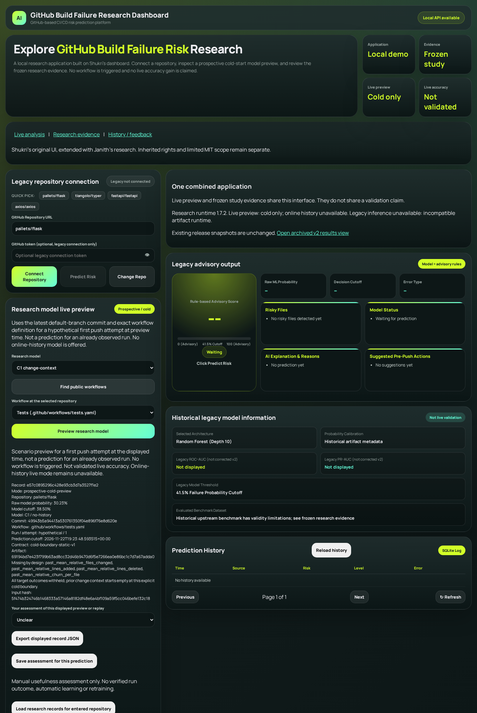
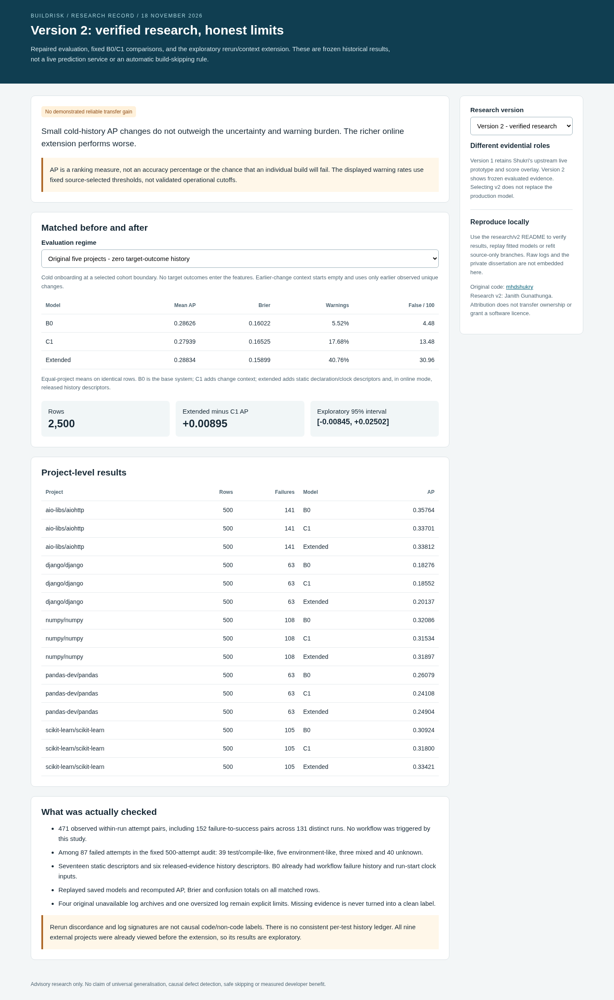

# CI/CD Build Failure Prediction: combined local research application

Unreleased review candidate. Shukri's original dashboard is extended with Janith's frozen research comparisons, strict cold-start model preview, local provenance records and prediction-bound usefulness assessments. This is not a deployed service or new evidence of model accuracy. Existing v1.0.0 and v2.0.0 snapshots are unchanged.

## Status and ownership

This is Janith Gunathunga's native public fork of Shukri's project. Version 1 is Shukri's original project; version 2 is Janith's research extension. Janith reports that Shukri gave him verbal permission to use and modify the project. This records Janith's account of that permission, not an open-source licence for inherited code or an ownership transfer.

Upstream has no licence file in the inspected revision. Inherited code and upstream-derived helpers retain their original rights. The MIT grant in `LICENSE-MIT-JANITH.txt` applies only to the independently authored additions explicitly listed in `LICENSING.md`, not the whole repository, inherited code, datasets or fitted models.

Native GitHub fork history includes a removed token-shaped literal in an old upstream commit. Janith reports that Shukri removed the token from GitHub's token settings, revoking it. Revocation has not been independently tested. The old value has never been used for this work. No new credential is included in the research additions. See `SECURITY.md`.



## What works in this candidate

| Function | Scope |
|---|---|
| Familiar dashboard | Original visual shell, repository inspection, commit/legacy display and history controls retained |
| Public live preview | B0, C1 or extended model for an explicit first-push cold-start scenario at preview time |
| Frozen evidence | All three historical regimes, project-level metrics and local fitted-model case replay |
| Provenance | Exact commit/workflow, real run/attempt for replay, cutoff, model/artifact, route, missingness, input hash and export |
| Local history / assessment | Exact-repository records and fixed usefulness choices tied to prediction ID; no learning |
| Unsupported paths | Inherited artifact inference is disabled under its incompatible runtime; no live online-history mode or verified run-outcome feedback |

A prospective preview is not a forecast retrospectively attached to a known run. Raw research probabilities are fractions in records and percentages in the UI. They are not altered by the legacy rule-based advice score. Frozen AP is not accuracy or a connected-repository failure rate. No reliable transfer gain, safe CI skipping, causal failure diagnosis or developer benefit is claimed.

## Start the combined application locally

Tested with Python 3.10.12 and the package versions in `requirements-combined.txt`. Use a separate virtual environment. Package availability and provider state can change.

```bash
python -m venv .venv
# Linux/macOS:
. .venv/bin/activate
# Windows PowerShell instead: .venv\Scripts\Activate.ps1
python -m pip install -r requirements-combined.txt
python -m uvicorn api.main:app --host 127.0.0.1 --port 8000
```

In a second terminal at the same repository root:

```bash
python -m http.server 8080 --bind 127.0.0.1
```

Open `http://127.0.0.1:8080/dashboard/index.html`. Keep both terminals open, then stop them with Ctrl+C when finished. Do not double-click the HTML file: the result JSON requires local HTTP.

1. Enter a public GitHub repository URL or owner/repository in the existing repository field.
2. Under **Research model live preview**, choose B0, C1 or extended, find workflows, select the intended workflow and preview it. This does not require the legacy Connect button and does not trigger CI.
3. Read the scenario notice, exact SHA/workflow/cutoff and raw probability. Unknown or unsupported metadata produces an error rather than a substitute score. GitHub calls are explicit manual actions, with no automatic polling or rate-limit retry.
4. Under **Research evidence**, switch study regimes, load frozen examples and replay one with the selected model. Historical replay is labelled, not passed off as a new forecast.
5. Export the displayed immutable record, save a usefulness assessment or load repository-scoped research records. These actions never update models.

The original **Connect Repository** control still fetches legacy commit/evidence fields. The separate **Predict Risk** legacy path reports unavailable while its trained artifact/runtime mismatch remains unresolved. The old unbound post-build feedback form is deliberately disabled. Do not bypass that gate or retrain on viewed target results to make the display work.

For a backend-free, frozen-results-only view, run just the static server and open `http://127.0.0.1:8080/dashboard/research-v2.html`. The integrated page also renders frozen evidence without the API, but discovery/replay/history need the local API. Missing/malformed JSON is recoverable through the explicit reload control.

### Credentials and local data

Anonymous public GitHub reads can hit rate limits. An authorized server-side `BUILDRISK_PUBLIC_READ_TOKEN` is optional. Configure it securely outside source and shell history; never paste it into code, committed configuration, screenshots or logs. The optional legacy session-token field is not browser-persisted, and legacy analysis no longer silently loads a repository `.env` token.

Local operational records use `data/research/buildrisk.sqlite3`, or an explicit `BUILDRISK_DATABASE_PATH`. Research records and fixed-choice assessments have separate tables; existing legacy records are not deleted or rewritten. Browser storage remembers repository identifiers only. Do not use this single-user application for shared or public hosting. It has no multi-user authentication or deployment security acceptance. See `SECURITY.md` and [provenance boundaries](docs/combined/06-provenance-history-feedback.md).

## Test and review

```bash
python -m pip install -r requirements-combined-test.txt
python -m playwright install chromium
python -m unittest discover -s tests -p 'test_*' -v
python tests/browser_error_states.py --screenshots evidence/errors
python tests/browser_combined.py --screenshots evidence/local
```

Browser acceptance is external-call-free by default. It distinguishes controlled UI responses from nine actual local model replays. A separately authorized public-metadata test can use the explicit `--live-public-repository` and `--workflow-id` arguments documented in [the acceptance report](docs/combined/07-acceptance-report.md). No enabled CI workflow is added.

Implementation reports are in [docs/combined](docs/combined/08-review-and-release.md). Review the stacked PRs in issue order #1 through #8. Do not merge, retag, publish a release or deploy until Janith approves. The candidate's implementation tests do not revise dissertation results or clear the thesis for submission.

## Preserved research views and releases

- Version 1: Shukri's original prototype snapshot, with original ownership and historical claims.
- Version 2: Janith's frozen research record. The screenshot below is the archived view, not the new combined interface.
- Combined candidate: unreleased implementation on review branches. No new release tag is created.



`README_V1.md` preserves the original README verbatim. Old paths and headline metrics there are historical and are not endorsed as corrected research results. GitHub shows HTML source; run the local HTTP steps above for an interactive application.

## Reproduce the new research

See [`research/v2/README.md`](research/v2/README.md). The bundle includes frozen features and predictions, source-stage manifests, fitted research models, portable verification/replay/refit commands, and the executed scientific scripts as archival records. It does not include raw CI logs, private dissertation files, private notes, credential material in this research bundle. The native fork separately retains upstream git history, including the security caveat above.

### Main results: equal-project average precision

| Regime | B0 | C1 | Extended |
|---|---:|---:|---:|
| Original 5, cold history (2,500 rows) | 0.28626 | 0.27939 | 0.28834 |
| Later 4, cold history (1,996 rows) | 0.28135 | 0.27583 | 0.28493 |
| Original 5, online history (2,500 rows) | 0.35450 | 0.35247 | 0.31116 |

AP is not accuracy. The extended-minus-C1 cold intervals include zero. All nine external projects were already viewed before the extension, so it is exploratory. In the original-five cold cohort, false alarms rise from C1 13.48 to extended 30.96 per 100 runs at the fixed source thresholds. Better cold AP is not evidence of operational benefit.

Observed same-recorded-head reruns and environment-like log signatures do not establish causal non-code failures. The fixed failure audit has 39 test/compile-like, five environment-like, three mixed and 40 unknown failures. Consistent per-test history is unavailable. No result is manufactured to fill that gap.

## Attribution and retained evidence

`UPSTREAM_PROVENANCE.json` records the exact upstream revision and snapshot hashes. Original rights remain with the respective authors. The complete private research archive remains the source for raw provider records and original execution layout. Frozen research pickles are included only for trusted local replay: never load an untrusted pickle/joblib file. Dependency versions are recorded for reproducibility, not a promise of indefinite compatibility.

No GitHub Actions workflow is enabled in the prepared snapshot. The inherited workflow is retained as a `.disabled` template so a push does not silently start external workflow activity. Enable it only after explicit review.
