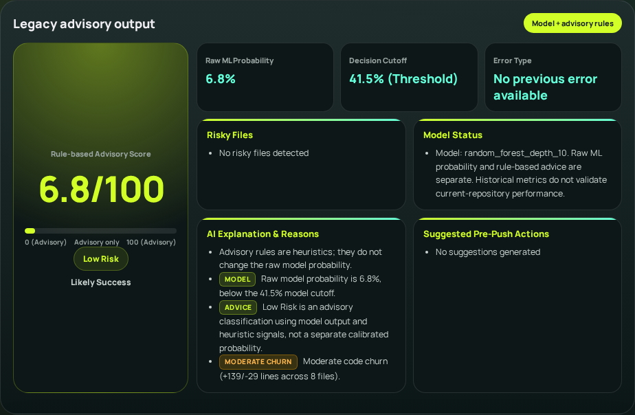

# Legacy model/runtime repair, issue #17

Review candidate only. No merge, release, retraining or new scientific claim.

## What changed

Shukri's legacy prediction path now serves a separately exported parameter artifact through `api/portable_legacy.py`. It does not load the original sklearn pickle at API startup or prediction time. The original artifact remains byte-for-byte intact beside the new files in `models/compatible/`.

The export preserves the fitted numeric median imputer and missing indicators, scaling, categorical most-frequent imputation and unknown-ignoring one-hot encoding, all 300 random-forest trees, binary class order, sigmoid calibration and original decision cutoff. Serving uses NumPy/pandas and a narrow evaluator for this reviewed structure. It refuses a missing, altered or unsupported artifact. There is no silent fallback to another model.

No fit, retraining, version-string editing or recalibration was done. Original sklearn version metadata reports 1.9.1. The app stays on Python 3.10/sklearn 1.7.2, while a separate Python 3.11.18 environment installed the genuine official sklearn 1.9.1 package. The original object loads and renders there with no version warnings. Portable predictions match that original on every listed source/stress input, and the app runtime separately matches the saved 1.9.1 outputs. The obstacle was Python compatibility: sklearn 1.9.1 requires Python 3.11 or later, not a nonexistent release.

## Provenance and reproduction

- Source: `models/saved/research_build_failure_model.joblib`, frozen in v2.0.0.
- Source fingerprint: `tests/fixtures/legacy-original-sha256.json`.
- Exported manifest: `models/compatible/legacy_rf_sigmoid_v1.json`.
- Exported arrays: `models/compatible/legacy_rf_sigmoid_v1.npz`, opened with `allow_pickle=False`.
- Manifest fingerprint is pinned in the evaluator; the manifest pins the arrays and source fingerprints.
- The manifest records the preprocessing schema, class order, calibration, cutoff, rights and comparison limits.

From the repository root, after installing `requirements-combined.txt` and the test requirements:

```bash
python tools/model_compat/export_legacy.py
python tools/model_compat/validate_legacy.py --portable-only-reference tests/fixtures/legacy_reference_191.npz
python -m unittest discover -s tests -p 'test_*' -v
python tests/browser_combined.py --screenshots evidence/legacy-regression
python tests/browser_error_states.py --screenshots evidence/legacy-errors
```

The export command is an offline maintenance tool. It deserializes only the fingerprint-checked repository artifact. Never use it with an untrusted pickle. It produces byte-identical JSON/NPZ in the tested environment. It is not needed to start the application.

For an independent recorded-version rerun, use Python 3.11 or later in a separate environment, not the application's Python 3.10 environment:

```bash
python3.11 -m venv .venv-legacy-reference
. .venv-legacy-reference/bin/activate
python -m pip install --index-url https://pypi.org/simple -r requirements-legacy-reference.txt
python tools/model_compat/validate_legacy.py --reference-output evidence/reference_191.npz
```

Official release/version evidence: [PyPI package](https://pypi.org/project/scikit-learn/1.9.1/), [release](https://github.com/scikit-learn/scikit-learn/releases/tag/1.9.1), [dependency table](https://scikit-learn.org/stable/min_dependency_table.html). The source's recorded version agrees with this real package and loads without a version warning; this is not a claim that every dependency from its unknown original training machine was recreated.

The reference outputs and their fingerprints are retained in `tests/fixtures/legacy_reference_191.npz` and its JSON metadata. The normal unit suite compares all rows against them without loading the original pickle. Machine-readable review evidence is in `docs/legacy-runtime/validation.json`, `cross-runtime-validation.json`, `browser-real.json`, `real-record-reference.json` and `preservation.json`. The recorded-version comparison covers all 20,974 available source-feature rows, with zero decision disagreements, plus 512 controlled cases combining missing values, unknown/missing categories and extreme finite numeric inputs. The first 256 transformed rows match exactly after float32 conversion. Probability differences are below 1e-12. Tests also cover an independent analytical toy forest, corrupt-artifact refusal, invalid/incomplete input, no original-pickle loading during serving, deterministic export, original-artifact preservation, and prediction-bound API history/assessment.

These are implementation checks on already available data, not new held-out evaluation or evidence of live accuracy.

## Dashboard and real-use check

Use the same local startup commands in the root README. **Connect & Fetch Repository**, then **Predict Risk**, now produces the legacy advisory output when the portable artifact passes validation. The strict research preview remains a separate choice.

A manual public-metadata browser test connected Janith's actual fork at master commit `126fced115603398886393def5deb95372c51af2`, predicted through the real local API, exported the exact record, saved a usefulness assessment, reloaded repository-scoped history, selected that prediction and assessed it again. Raw probability was 0.06781355800113309, displayed as 6.8%; the separate advisory score was 6.8/100 for that case. They happen to round to the same number here and are not interchangeable quantities. No CI run was triggered. This check used an isolated temporary database, not production history. The optional public-read token was not persisted and was cleared before screenshots.

Desktop and 390px mobile views were checked. A real 40-character commit SHA exposed an inherited mobile overflow around the copy control. The SHA can now wrap while its button stays usable; long file/evidence text and history buttons can wrap too. The advisory meter is labelled as advice only, with the probability cutoff kept in its separate raw-model metric. The real-use rerun passed with no horizontal page overflow or browser errors. Controlled browser regression also covers portrait/landscape views, nine actual frozen-model replays, and 16 malformed/missing-data cases with 16 successful retries.



## Important boundaries

- This is the legacy prototype feature/default contract, not the corrected strict cold-start contract. Missing historical evidence may still use the inherited defaults of 50 prior runs and 10% failure rate. These are not measured history. A zero-rate legacy-history fallback remains inherited behavior, not a new scientific method.
- Each legacy record stores exact inference features, missing values, commit, timestamp, cutoff, artifact hash, raw probability and a separate advisory score. It identifies the prototype route and default policy.
- Rule-based advice never changes raw model probability. Usefulness assessment is not a verified CI outcome and does not retrain the model. The unbound old post-build feedback path remains disabled.
- Existing v1/v2 releases, original models, frozen research data/results and thesis files are unchanged. No hosted CI is enabled.
- Shukri and original contributors retain credit. The new export is derived from the inherited fitted artifact and remains outside the limited four-file MIT grant. Reported verbal permission is not an open-source licence or ownership transfer. See `LICENSING.md`.
- Wait for Janith's approval before merge or release.
